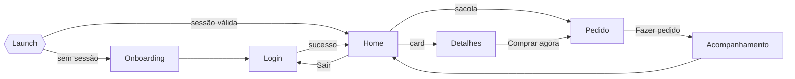

# ☕ Coffee Shop — Design System + Sample App (Flutter · MVVM)

Projeto da disciplina **Mobile II**. Reconstrói em Flutter o Design System do arquivo Figma
[**Coffee Shop Mobile App Design (Community)**](https://www.figma.com/design/JpAfa1wvkvsNYCqNHDupoe/Coffee-Shop-Mobile-App-Design--Community-)
e usa esse Design System para construir um app de cafeteria completo, aplicando os padrões
de projeto estudados no semestre (MVVM, Factory, Coordinator, Delegate, Repository...).

| Entrega | Onde está |
|---|---|
| 1. Tema do app | `packages/design_system/lib/src/foundations/` · [docs/DESIGN_SYSTEM.md](docs/DESIGN_SYSTEM.md) |
| 2. Protótipo das telas | [Figma — Coffee Shop · Protótipo MVVM](https://www.figma.com/design/8qy8qmLBgPNBWZfcm4jEw6) |
| 3. Biblioteca de componentes | `packages/design_system/lib/src/components/` |
| 3. Sample App do Design System | `packages/design_system/example/` |
| 3. App | `lib/` (cenas MVVM) |
| 4. Documentação da API | [docs/API.md](docs/API.md) |
| Arquitetura e padrões | [docs/ARQUITETURA.md](docs/ARQUITETURA.md) |

---

## 1. Visão geral do sistema

O repositório é dividido em três partes independentes:

```
┌───────────────────────── App (lib/) ─────────────────────────┐
│ Cenas MVVM: Launch · Onboarding · Login · Home · Detalhes ·  │
│ Pedido · Acompanhamento                                      │
└───────────────┬──────────────────────────────┬───────────────┘
                │ usa                          │ usa
┌───────────────▼──────────────┐ ┌─────────────▼────────────────┐
│ packages/design_system       │ │ packages/core                │
│ Tokens, tema claro/escuro e  │ │ Modelos, ApiClient (contrato)│
│ 18 componentes               │ │ servidor mockado, sessão,    │
│ + Sample App (example/)      │ │ carrinho e repositórios      │
└──────────────────────────────┘ └──────────────────────────────┘
```

- **Design System** — não conhece regras de negócio. Só tokens visuais e componentes.
- **Core** — não conhece telas. Só dados: modelos, contrato da API e implementação mockada.
- **App** — junta os dois em cenas, uma pasta por tela.

## 2. Funcionalidades do app

| Tela | O que faz |
|---|---|
| **Launch** ("tela invisível") | Verifica se existe sessão salva e se o token ainda vale. Vai direto para a Home ou para o Onboarding |
| **Onboarding** | Tela de boas-vindas da marca, botão "Começar" |
| **Login** | E-mail e senha com validação, mensagens de erro da API, estado de carregamento |
| **Home** | Localização, busca, filtro, banner promocional, abas de categoria, grade de produtos, botão "+" que adiciona ao carrinho, favoritos, sacola com contador, tema claro/escuro e sair |
| **Detalhes** | Foto, avaliação, diferenciais, descrição com "Ler mais", tamanhos S/M/L com preço por tamanho, favoritar, "Comprar agora" |
| **Pedido** | Entregar ou retirar, endereço, itens com controle de quantidade, desconto, resumo recalculado pela API a cada mudança, forma de pagamento, "Fazer pedido" |
| **Acompanhamento** | Tempo restante, barra de 4 etapas, status do pedido e card do entregador. "Atualizar status" avança o pedido no servidor mockado |

**Login de demonstração:** `ana@coffee.dev` / `123456`

## 3. Design System

### Tema

Os tokens vêm dos estilos *Color Foundation* do Figma. O tema escuro é uma extensão deste
projeto, porque o Figma só define o claro. Os componentes nunca usam hexadecimal: leem
papéis semânticos com `context.colors.<papel>`.

| Token | Claro | Escuro |
|---|---|---|
| `primary` | `#C67C4E` | `#C67C4E` |
| `primaryContainer` | `#F9F2ED` | `#3B2A20` |
| `background` | `#F9F9F9` | `#141110` |
| `surface` | `#FFFFFF` | `#211C19` |
| `textPrimary` | `#242424` | `#F5EDE8` |
| `textSecondary` | `#A2A2A2` | `#A89C94` |
| `border` | `#E3E3E3` | `#3D342E` |

- **Tipografia:** Sora — `display 32`, `headline 20`, `title 16`, `body 14`, `caption 12`, `price 18`...
- **Espaçamento:** 4 · 8 · 12 · 16 · 24 · 32 · 48 (margem lateral das telas = 24)
- **Raios:** 6 · 8 · 12 · 16 · 24

A tabela completa está em [docs/DESIGN_SYSTEM.md](docs/DESIGN_SYSTEM.md).

### Componentes

Cada componente fica em `packages/design_system/lib/src/components/<nome>/` com três arquivos:

| Arquivo | Papel |
|---|---|
| `<nome>_view_model.dart` | Dados e estado de uma instância, mais os callbacks delegados (`onPressed`, `onChanged`...) |
| `<nome>_factory.dart` | Cria as variantes válidas do Figma (`primary`, `addItem`, `size`...) |
| `<nome>_component.dart` | Widget que só desenha a ViewModel |

Componentes disponíveis: **ActionButton**, **AppTextField**, **SelectableChip**, **CategoryTabs**,
**SegmentedControl**, **BottomNavBar**, **TopBar**, **ProductCard**, **PromoBanner**,
**FeatureBadge**, **QuantityStepper**, **CartItemTile**, **ActionTile**, **SummaryRow**,
**StepProgress**, **StatusCard**, **StateView** e **AppMessage**.

```dart
// Na ViewModel da cena
ActionButtonViewModel get buyButton => ActionButtonFactory.primary(
      label: 'Comprar agora',
      isEnabled: product.isAvailable,
      onPressed: buyNow, // Delegate: o botão não sabe o que acontece
    );

// Na View
ActionButtonComponent(viewModel: vm.buyButton)
```

### Sample App do Design System

`packages/design_system/example/` é um catálogo vivo (como um Storybook). Mostra todos os
tokens e todas as variantes e estados de cada componente, nos dois temas, chamando as mesmas
factories que o app usa.

## 4. Arquitetura — MVVM com cenas

Cada tela é uma **cena** em `lib/scenes/<cena>/` com cinco papéis:

| Arquivo | Responsabilidade |
|---|---|
| `<cena>_factory.dart` | `make()` cria Server, Coordinator e ViewModel, e devolve a View pronta |
| `<cena>_view.dart` | Interface. Só desenha e repassa eventos para a ViewModel |
| `<cena>_view_model.dart` | Estado e ações (`ChangeNotifier`). Recebe o Server e o Coordinator |
| `<cena>_coordinator.dart` | Navegação e mensagens |
| `<cena>_server.dart` | Protocolo do servidor (interface) e sua implementação |

```dart
// server → coordinator → viewModel(server, coordinator) → View(viewModel)
static Widget make() {
  final server = DefaultLoginServer(authRepository: deps.authRepository);
  final coordinator = DefaultLoginCoordinator();
  final viewModel = LoginViewModel(server: server, coordinator: coordinator);
  return LoginView(viewModel: viewModel);
}
```

### Fluxo de navegação



### Padrões de projeto aplicados

| Padrão | Onde |
|---|---|
| **MVVM** | Todas as cenas |
| **Factory** | `*Factory.make()` das cenas e factories dos componentes |
| **Coordinator** | Navegação fora da View e da ViewModel |
| **Delegate** | Callbacks das ViewModels de componente |
| **Strategy / Protocolo** | `ApiClient` (mock ou HTTP real), `SessionStore`, `*Server` |
| **Decorator** | `AuthorizedApiClient` adiciona o token a toda requisição |
| **Repository** | `AuthRepository`, `CatalogRepository`, `OrderRepository` |
| **Observer** | `CartStore`, `FavoritesStore`, `ThemeController` |
| **Singleton** | `AppDependencies.instance` (composition root) |
| **Composite** | `CategoryTabs` (feito de chips), `CartItemTile` (contém um stepper) |

Detalhes, diagrama de sequência e regras em [docs/ARQUITETURA.md](docs/ARQUITETURA.md).

## 5. API

O app consome uma API REST em JSON. Hoje ela é atendida por um **servidor mockado**
(`packages/core/lib/src/api/mock_api_client.dart`) que responde exatamente com os caminhos,
códigos HTTP e corpos documentados. Para usar um backend real, basta implementar `ApiClient`
com HTTP e trocar em `lib/app/app_dependencies.dart`.

| Método | Rota | Uso |
|---|---|---|
| POST | `/auth/login` | Login |
| POST | `/auth/logout` | Sair |
| GET | `/me` | Usuário logado |
| GET | `/categories` | Abas de categoria |
| GET | `/products?categoryId=&q=` | Grade da Home e busca |
| GET | `/products/{id}` | Detalhes |
| GET | `/promotions` | Banner |
| POST | `/orders/quote` | Resumo do pagamento |
| POST | `/orders` | Criar pedido |
| GET | `/orders/{id}` | Acompanhamento |

Exemplos de request/response e todos os códigos de erro estão em [docs/API.md](docs/API.md).

## 6. Estrutura de pastas

```
.
├── lib/
│   ├── main.dart
│   ├── app/                    # Composition root, navegação global, CoffeeApp
│   └── scenes/                 # launch, onboarding, login, home, product_detail, order, order_tracking
├── packages/
│   ├── design_system/
│   │   ├── lib/src/foundations/  # Cores, tipografia, espaçamento, tema
│   │   ├── lib/src/primitives/   # ProductImage, RatingLabel, SectionTitle
│   │   ├── lib/src/components/   # 18 componentes (Component/ViewModel/Factory)
│   │   └── example/              # Sample App do Design System
│   └── core/
│       ├── lib/src/api/          # ApiClient, MockApiClient, MockDatabase
│       ├── lib/src/models/       # User, Product, Order...
│       ├── lib/src/repositories/
│       ├── lib/src/session/      # SessionStore ("chave salva")
│       └── test/                 # Contrato da API
├── test/                       # Testes das ViewModels com fakes
├── assets/images/              # Fotos exportadas do Figma
└── docs/                       # API, Design System, Arquitetura
```

## 7. Como rodar

Pré-requisito: **Flutter 3.27** ou mais novo.

```bash
# Gera as pastas de plataforma (android/, ios/, web/) sem sobrescrever lib/ e test/
flutter create --platforms=android,ios,web .
flutter pub get
flutter run
```

Sample App do Design System:

```bash
cd packages/design_system/example
flutter create --platforms=android,ios,web .
flutter run
```

**Imagens (opcional):** exporte as fotos do Figma para `assets/images/` com os nomes listados em
[assets/images/README.md](assets/images/README.md). Sem elas, o app mostra placeholders com as
cores da marca.

## 8. Testes

```bash
flutter analyze
flutter test                          # ViewModels: Launch, Login, Home, Pedido
cd packages/core && flutter test      # Contrato do servidor mockado
```

Os testes trocam o Server e o Coordinator reais por *fakes*, o que só é possível porque as
ViewModels dependem de interfaces.

## 9. Histórico

A versão anterior deste repositório era só um catálogo de componentes (`lib/common`,
`lib/components`, `lib/screens`). Nesta versão:

- os tokens e componentes foram movidos para o pacote `packages/design_system`, seguindo o
  Figma (paleta *Color Foundation*, fundo `#F9F9F9` etc.);
- o catálogo virou o Sample App em `packages/design_system/example`;
- o app passou a ser construído em cenas MVVM com Server, Coordinator e API mockada.

## Créditos

Design original: *Coffee Shop Mobile App Design* (Figma Community). Este projeto reimplementa
os tokens e as telas em Flutter para fins de estudo.
