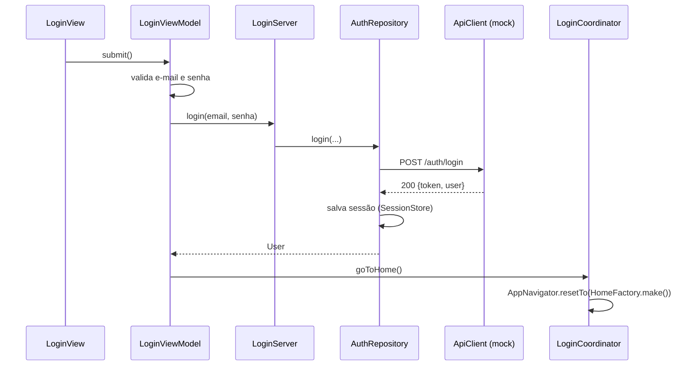
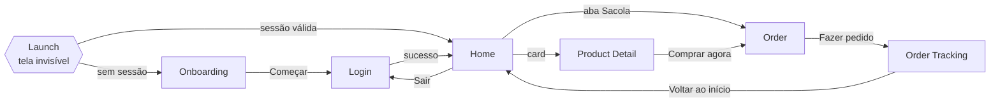

# Arquitetura — MVVM com cenas

## Visão geral

```
┌────────────────────────────── App (lib/) ──────────────────────────────┐
│  main.dart → CoffeeApp → LaunchFactory.make()                          │
│                                                                        │
│  scenes/<cena>/                                                        │
│    <cena>_factory.dart      monta tudo e injeta dependências           │
│    <cena>_view.dart         só desenha a partir da ViewModel           │
│    <cena>_view_model.dart   estado + ações (ChangeNotifier)            │
│    <cena>_coordinator.dart  navegação e mensagens                      │
│    <cena>_server.dart       protocolo + implementação de dados         │
│                                                                        │
│  app/app_dependencies.dart  Composition Root (Singleton)               │
│  app/app_navigator.dart     navigatorKey + showAppMessage              │
└──────────────┬──────────────────────────────────────┬──────────────────┘
               │ usa                                  │ usa
┌──────────────▼───────────────┐      ┌───────────────▼──────────────────┐
│ packages/design_system       │      │ packages/core                    │
│ tokens · tema · componentes  │      │ modelos · ApiClient (protocolo)  │
│ (Component/ViewModel/Factory)│      │ MockApiClient · repositórios     │
│                              │      │ SessionStore · CartStore         │
└──────────────────────────────┘      └──────────────────────────────────┘
```

## Fluxo de uma cena

Exatamente o esquema visto em aula:

```dart
// factory.make() → View (tela pronta para uso, visual e lógica)
static Widget make() {
  final server = DefaultLoginServer(authRepository: deps.authRepository);
  final coordinator = DefaultLoginCoordinator();
  final viewModel = LoginViewModel(server: server, coordinator: coordinator);
  return LoginView(viewModel: viewModel);
}
```



## Mapa de navegação



| Cena | Server (rotas) | Coordinator |
|---|---|---|
| Launch | `GET /me` | → Onboarding / Home |
| Onboarding | — (sem dados) | → Login |
| Login | `POST /auth/login` | → Home, mensagem de erro |
| Home | `GET /me`, `/categories`, `/promotions`, `/products`, `POST /auth/logout` | → Detail, Order, Login |
| Product Detail | `GET /products/{id}` | ← voltar, → Order |
| Order | `POST /orders/quote`, `POST /orders` | ← voltar, → Tracking |
| Order Tracking | `GET /orders/{id}` | → Home |

## Sessão ("chave salva") e a tela invisível

`InMemorySessionStore` guarda a sessão num dicionário sob a chave
`coffee.session`. A **Launch** é a "tela invisível": ao abrir o app ela
verifica se a chave existe e se o token ainda vale (`GET /me`).

- Existe e vale → vai direto para a Home.
- Não existe ou expirou → Onboarding → Login.
- Logout → a chave é apagada, o carrinho é limpo e o login é reconstruído
  com `resetTo` (a pilha de telas é descartada).

## Padrões de projeto usados

| Padrão | Onde |
|---|---|
| **MVVM** | Cada cena: View ↔ ViewModel (`ChangeNotifier`) ↔ Server |
| **Factory** | `*Factory.make()` das cenas e `*Factory` dos componentes do DS |
| **Coordinator** | `*Coordinator`: navegação fora da View e da ViewModel |
| **Delegate** | Callbacks das ViewModels de componente (`onPressed`, `onChanged`, `onSelected`) |
| **Strategy / Protocolo** | `ApiClient` (mock ↔ HTTP real), `SessionStore`, `*Server` |
| **Decorator** | `AuthorizedApiClient` adiciona o token a toda requisição |
| **Repository** | `AuthRepository`, `CatalogRepository`, `OrderRepository` |
| **Observer** | `CartStore`, `FavoritesStore`, `ThemeController` e as ViewModels |
| **Singleton / Composition Root** | `AppDependencies.instance` |
| **Composite** | `CategoryTabs` (chips) e `CartItemTile` (contém `QuantityStepper`) |

## Regras seguidas

1. A View não tem regra de negócio — no máximo layout e repasse de eventos.
2. A ViewModel não conhece `BuildContext` nem `Navigator` — fala com o Coordinator.
3. O Coordinator não guarda estado — só navega e mostra mensagens.
4. O Server é uma **interface**; testes usam fakes (`test/scenes/`).
5. Componentes do DS não conhecem modelos de domínio (`Product`, `Order`):
   recebem texto já formatado pela ViewModel da cena.

## Testes

```bash
flutter test                         # cenas: Launch, Login, Home, Order
cd packages/core && flutter test     # contrato do servidor mockado
```
